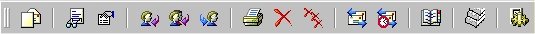
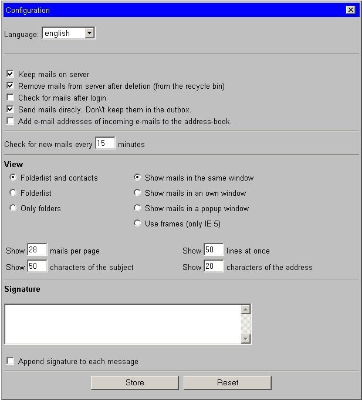
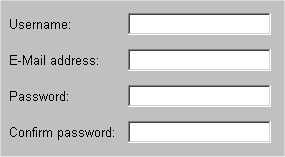

# Popper

A web mail client for POP3 accounts, written in PHP 4 with a MySQL back end,
developed between November 2000 and March 2006. Versions 1 to 1.42.

> **Do not deploy this.** Popper is 2001-era PHP 4 code. It relies on
> practices that are known to be weak today: the POP3 passwords of all users
> are stored in plain text in the database (see `INSTALL`, section "Security
> issues"), the code predates modern input validation and session-handling
> practice, and it has not been maintained since 2006. The repository is an
> archive for historical interest.

## What it does

From `INSTALL`:

> Popper is a web based mail-client which allows you to read mails from
> different POP3 accounts.
> Accessing a POP3 account from different computers is not always
> easy. Web-based mail solutions like hotmail.com etc. are an option, but
> not the best solution.
>
> There are already PHP web interfaces to read POP3 mails, but most of them
> require that PHP is compiled with the --with-imap options which is mostly not
> the case.
>
> Popper tries to fill this gap. It gives you the possibility to read and write
> your mails from (almost ;-) any web-browser from any place.
> It's MIME conformant. This means that you also can get and send attachments.

Features, as they accumulated in `CHANGE-LOG`:

- Own POP3 client (`class.pop3.inc.php`) with UIDL tracking so that mails are
  not fetched twice, including an own X-UIDL implementation for servers without
  UIDL support.
- Several POP3 accounts per user, user self-registration (`newuser.form`),
  lost-password mail, user configuration pages, admin-free operation.
- MIME parsing and composing (`class.mimepart.inc.php`, `class.mailer.inc.php`,
  `class.headers.inc.php`): attachments, `multipart/related` with inline
  images, `message/rfc822`, quoted-printable and base64, own quoted-printable
  decoder because PHP's was buggy.
- Mail folders, read/replied/forwarded state, priorities, sorting, paging,
  configurable number of mails and lines per page, printable view
  (`print.css`).
- Address book with automatic capture of senders.
- Calendar (`class.cal.inc.php`, `cal.form.inc.php`).
- No JavaScript at all ("you can even use lynx"), layout through CSS only
  (`style.css`).
- Languages in `lang/`: German, English, French, Lithuanian, Dutch, Norwegian,
  Russian (KOI8 and Windows-1251).
- Database schema and migration scripts: `popper.mysql`, `update*.mysql`,
  `update14.php`.

## Screenshots

The images used by the built-in help page (`help.form.inc.php`):

| | |
|---|---|
|  |  |
|  |  |

Also available: `graphics/help_config.jpg`, `graphics/help_config_de.jpg`.

## Installation (historical)

See `INSTALL`. In short: a web server with PHP 4 and MySQL, create the
database from `popper.mysql`, move `popper.inc.php` (database credentials)
above the document root, edit `config.inc.php`, create a world-writable `tmp/`
directory. The file shipped here contains placeholder credentials only.

## Versions

| Version | Date | Notes |
|---|---|---|
| 1 to 1.102 | November to December 2000 | Initial releases, before version control. |
| 1.2 | December 2000 / January 2001 | Better MIME handling, address book capture, help page. |
| 1.21 | January 2001 | Attachments, `multipart/related`, `message/rfc822`, own X-UIDL. Beginning of the history in this repository. |
| 1.3, 1.31, 1.32 | February 2001 | Language files (German, English, French, Norwegian, Russian), printable view, confirmation mails, bug fixes. |
| 1.4 (betas b3 to b7), 1.4, 1.41 | February 2001 | Calendar, mail priorities and read/replied/forwarded state, disposition notifications, Lithuanian language, migration scripts `update14*.mysql`. |
| 1.41-r1, 1.41-r2 | 2003 to 2005 | register_globals=off work by thesaur (2003); `$_SESSION` rework, MySQL 4 reserved-word fix and "Send and Receive All" by roytoo (2005). |
| 1.42 | March 2006 | Last release (`config.inc.php`: `POPPER_VERSION = "1.42"`), bug fixes by blackdrake. |

## History of this repository

The history was assembled from every surviving source, oldest first:

1. The root commit is the author's working copy of 20 November 2000, recovered
   from a machine backup of 2001, before any version control.
2. January and February 2001: the CVS module `popper` of the SourceForge
   project **hpcomm** (Popper started as a side project next to the HPComm
   Palm/PC tool), converted directly from the CVS files.
3. February 2001 to March 2006: the CVS repository of the SourceForge project
   **popper** (<http://sourceforge.net/projects/popper>), converted directly
   from the original `,v` files with cvs-fast-export, including the eleven
   release tags and the `popper-V1_41-bugfixes-branch`. The earlier git-svn
   conversion of the cvs2svn mirror was discarded because it had flattened
   line endings and damaged every image by CR to LF conversion; the CVS files
   themselves hold the images intact.
4. The final commits add this README and the licence files.

Four branches named `backup-2001/*` hold working copies from the same 2001
backup that never reached CVS, each as a single commit on top of the closest
mainline commit:

- `backup-2001/popper-neu` (5 February 2001): the first mail-folder experiment
  (`newfolder.form.inc.php`, folder graphics).
- `backup-2001/popper-folder` (13 February 2001): the folder experiment
  continued (`move.form.inc.php`, `newfolder.form.inc.php`) plus the MIME
  torture-test mailbox.
- `backup-2001/popperleo` (27 February 2001): a restructured fork of version
  1.32 by a contributor named Leo (themes, `css/`, `lib/cls.panel.php`).
- `backup-2001/popper-sourceforge-2001-04` (12 April 2001): the SourceForge
  working copy with uncommitted work towards version 1.5 (`class.gui`,
  `class.window`, `install.php`, themes, `update15.mysql`).

Contributors as recorded in the log (`git shortlog -sne`):

| Author | Commits | Period |
|---|---|---|
| Jean-Pierre Bergamin (SourceForge `jbergamin`) <james@ractive.ch> | 66 + 2 archive commits | November 2000 to February 2001 |
| roytoo <roytoo@users.sourceforge.net> | 30 | February to August 2005 |
| blackdrake <blackdrake@users.sourceforge.net> | 14 | March 2006 |
| thesaur <thesaur@users.sourceforge.net> | 1 | July 2003 |

## Licence

GNU General Public License, version 2 (see `LICENSE`, identical to the
original `gpl.txt`).

## Where it was published

- SourceForge project `popper`, registered 22 November 2000:
  <https://sourceforge.net/projects/popper/>. Releases: 1.2beta (8 Jan 2001),
  1.21beta (5 Feb 2001), 1.32 (14 Feb 2001), 1.4b6 (17 Feb 2001), 1.4 and
  1.41 (24 Feb 2001), 1.41-p1/r1/r2 (February 2005, by the later maintainers).
  Tarballs: <https://sourceforge.net/projects/popper/files/>.
- Project site at the time: <http://popper.ractive.ch> (the ractive.ch
  mailing-list page of February 2001 counted 78 subscribers, the largest of
  all @ractive projects).
- Listed in the FSF Free Software Directory: <https://directory.fsf.org/wiki/Popper>.
- Security advisory: CVE-2005-1870, a remote file inclusion in
  `childwindow.inc.php` of Popper 1.41. One more reason not to run this code.
